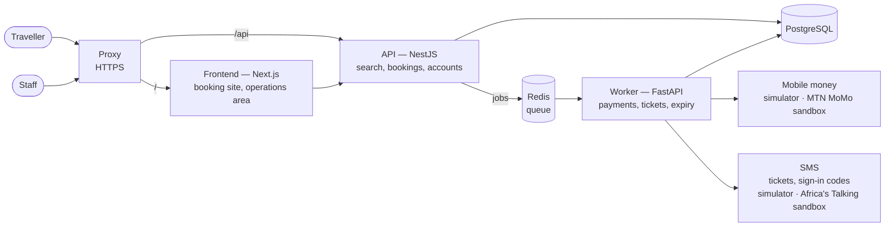

# devops-lab

A learning lab where I take a real-world **full-stack** app, a ferry ticket booking system for Lake Kivu with a **Next.js frontend, a NestJS API, a Python worker, PostgreSQL and Redis**, along the whole path from code to production, one DevOps tool at a time: from my laptop to a tested build, through a pipeline that integrates and deploys every change, onto a single server, then AWS and Kubernetes, and finally monitoring it and releasing changes safely.

## The app

Travellers search a trip (*Goma → Bukavu, Saturday 07:00*), pick a seat on the boat and pay with mobile money; once the payment is confirmed, they receive their ticket by SMS. They can book as a guest or sign in with their phone number and a one-time code to keep all their trips in one place. Staff (agents and managers) sign in with two-factor authentication to follow and export bookings and manage staff accounts.



The API answers travellers and never waits on an external provider. Everything slow or unreliable (payments, SMS, expiring unpaid bookings) goes through a queue to the worker. The database guarantees that a seat is never sold twice and that each confirmed booking gets exactly one ticket, even when jobs are retried.

The frontend is self-hosted with the rest of the system, not deployed to Vercel. That's a deliberate choice for learning: running Next.js yourself (containers, scaling, caching across replicas, a CDN for static files) is the DevOps work a managed platform hides. See [ADR-0002](docs/adr/0002-self-host-the-frontend.md).

No real money or SMS is involved. On a laptop, payments and SMS go to built-in simulators that can be made slow or failing on demand; staging uses the free [MTN MoMo](https://momodeveloper.mtn.com/) and [Africa's Talking](https://developers.africastalking.com/) sandboxes ([ADR-0003](docs/adr/0003-provider-sandboxes-in-staging.md)). Requirements, booking lifecycle and data model: [app design](docs/architecture/app.md).

**App stack:** Next.js, NestJS, FastAPI, PostgreSQL, Redis

**Infrastructure stack:** DigitalOcean, Nexus, Docker, Jenkins, GitHub Actions, AWS (VPC, EC2, RDS, ElastiCache, S3, CloudFront, ECR, EKS), MinIO, Kubernetes, Helm, Argo CD, Argo Rollouts, OpenFeature, Terraform, Ansible, Prometheus, Grafana, Loki

## How it's organised

Each chapter takes one tool and applies it to the app. Chapters are published as I finish them; the table below is the full roadmap. A chapter's README lists its goals, and for each goal: why it matters, how I did it, the check that proves it works, and what I found. Each chapter also breaks something on purpose and records the result.

Chapters build on each other. When a chapter is finished it's tagged `chapter-NN-done`, so you can check out the repo as it was at any point:

```bash
git checkout chapter-08-done    # the state chapter 09 starts from
```

Chapter 01 is the exception: it covers Linux on a throwaway VM, not on the app.

| Chapter | What it adds | Status |
|---|---|---|
| **Foundations, on my laptop** | | |
| 01 · Linux fundamentals | The DevOps essentials: services, troubleshooting, permissions, networking, SSH and Bash | In progress |
| 02 · Databases (PostgreSQL) | Performance, connections and safe changes | Planned |
| 03 · Build tools (npm, uv) | From source code to a reliable, deployable package | Planned |
| **Build, integrate, deploy** | | |
| 04 · Cloud servers (DigitalOcean) | Creating, securing and serving an app on a VPS | Planned |
| 05 · Artifact repository (Nexus) | Versioning, publishing and restoring releases | Planned |
| 06 · Containers (Docker, Compose) | Building production images and running the stack anywhere | Planned |
| 07 · CI/CD (Jenkins, GitHub Actions) | Building a pipeline that tests, deploys and recovers on its own | Planned |
| **Scale in the cloud** | | |
| 08 · AWS (VPC, EC2, RDS) | Building a highly available setup across two zones, step by step, before automating it | Planned |
| 09 · Object storage (S3, CloudFront) | Storing, protecting and serving private files | Planned |
| 10 · Kubernetes (k3d, Helm) | Packaging, scaling and deploying the stack with zero downtime | Planned |
| 11 · Kubernetes on AWS (EKS, Argo CD) | From a local cluster to production, deployed from Git | Planned |
| 12 · Infrastructure as Code (Terraform) | From hand-built AWS to reproducible environments | Planned |
| **Automate and operate** | | |
| 13 · Python (pytest, httpx) | From a manual spreadsheet task to a tested CLI | Planned |
| 14 · Python automation (boto3) | Cutting AWS waste, backing up the database and testing restores | Planned |
| 15 · Configuration management (Ansible) | Configuring a fleet of servers, keeping them in sync with the code and detecting drift | Planned |
| 16 · Monitoring (Prometheus, Grafana, Loki) | Measuring the app, alerting on problems and detecting outages before users do | Planned |
| **Release safely** | | |
| 17 · Progressive delivery (Argo Rollouts, OpenFeature) | Releasing to a few users first and rolling back automatically | Planned |

**Planned: beyond the web.** Two more chapters add native clients on top of the same API: a mobile app for travellers and a desktop app for operations staff. They'll be done once test devices and store accounts are available.

| Chapter | What it adds | Status |
|---|---|---|
| 18 · Mobile app (React Native, Expo) | Building, signing and shipping a mobile app to the stores | Planned |
| 19 · Desktop app (Tauri) | Building, signing and auto-updating a desktop app on Windows, macOS and Linux | Planned |

## How to run a chapter

**Prerequisites**

- Git, Docker, and a Linux, macOS or WSL2 machine
- A DigitalOcean account from chapter 04
- An AWS account from chapter 08. Set a budget alert first, and destroy resources after each session.

**Steps**

```bash
git clone https://github.com/CREDO23/devops-lab
cd devops-lab
git checkout chapter-NN-done    # the chapter before the one you want
```

Then follow that chapter's README. Each goal has a ✅ check, so you know when it works.

## Repository layout

```text
labs/       one README per chapter
app/        the booking app: web (Next.js), api (NestJS) and worker (FastAPI)
infra/      what the chapters build: scripts, docker, ci, terraform, k8s, ansible, monitoring
docs/       app design, decisions (ADRs), and later runbooks and postmortems
```

Folders appear as the work that fills them is published.
