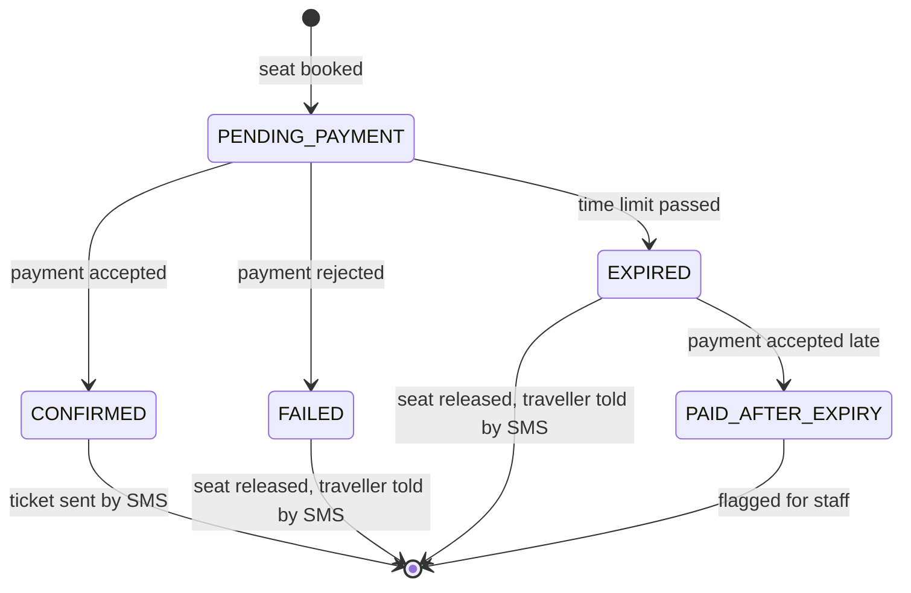
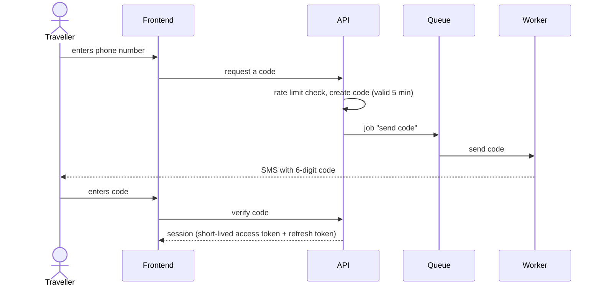
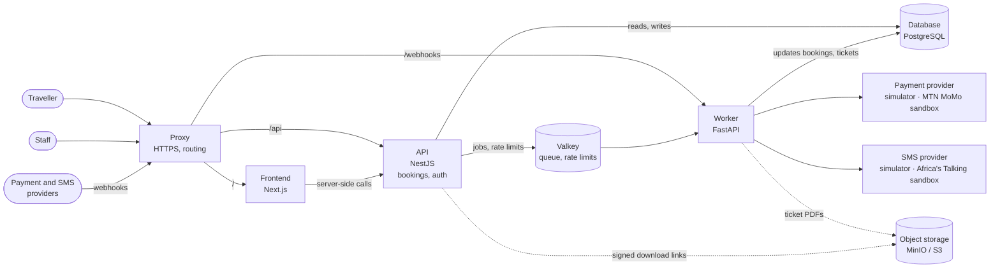
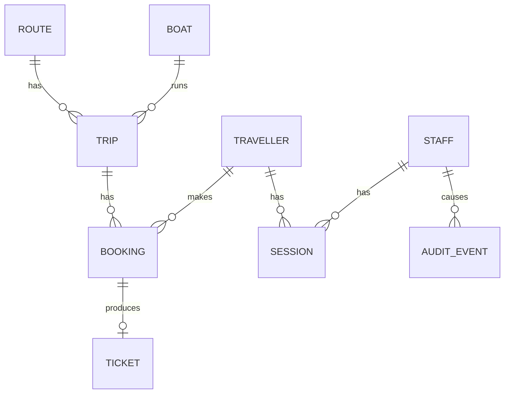

# App design: Kivu Ferry booking

## 1 · Purpose and scope

A full-stack ferry ticket booking product for Lake Kivu, serving the Congolese side of the lake (Goma, Bukavu, Idjwi, Minova, Kalehe), with fares in US dollars, in English, French and Swahili. It's designed as a real product, and built to be **operated**: deployed, scaled, broken and monitored.

**In scope:**
- A booking website for travellers: search trips, pick a seat, pay, follow the booking, view the ticket
- Traveller accounts: sign in with a phone number and a one-time code, "My trips"; booking as a guest stays possible
- An operations area for staff: sign in with two-factor authentication, follow and export bookings, with roles
- Everything behind them

**Planned:** a mobile app for travellers and a desktop app for operations staff, both using the same API as the website. They'll send tokens in a header rather than cookies ([ADR-0007](../adr/0007-sessions-in-httponly-cookies.md)).

**Out of scope for now:** real payments and real SMS (a simulator locally, the MTN MoMo and Africa's Talking sandboxes in staging), refunds and cancellations, managing routes, boats and timetables from the interface.

**Arrives with a later chapter:** the first version of the app is written before chapter 02. Whatever is really an infrastructure concern waits for the chapter that covers it: performance work and the data generator (02), the proxy (04), PDF tickets and object storage (09), metrics (16). Those items are marked *(from chapter NN)* below.

## 2 · Actors

| Actor | What they do |
|---|---|
| Traveller (guest) | Searches trips, books a seat with a phone number, pays, receives a ticket |
| Traveller (signed in) | Everything a guest does, plus sees all their trips and doesn't retype their details |
| Agent (staff) | Follows bookings and looks up a traveller's booking at the port |
| Manager (staff) | Everything an agent does, plus exports bookings and manages staff accounts |
| Mobile money provider *(simulator locally, MTN MoMo sandbox in staging)* | Confirms or rejects payments, and reports the result to a webhook |
| SMS provider *(simulator locally, Africa's Talking sandbox in staging)* | Delivers tickets and sign-in codes, and reports delivery to a webhook |

## 3 · Functional requirements

### Booking

| ID | Requirement |
|---|---|
| F1 | A traveller can search trips by origin, destination and date |
| F2 | A traveller can see which seats are still free on a trip, on a seat map |
| F3 | A traveller can book one seat, signed in or as a guest with a phone number |
| F4 | **A seat can never be sold twice**, even if two people book it at the same moment |
| F5 | Payment happens asynchronously; the booking is confirmed or failed afterwards. A retried payment request never charges twice |
| F6 | A seat held by an unpaid booking is released after a time limit (10 minutes) |
| F6a | If a payment succeeds after its booking expired, the booking is flagged for staff; refunds are out of scope |
| F7 | A confirmed booking produces exactly **one** ticket, sent by SMS, even if a step is retried. The SMS itself is sent at least once: a crash right after sending can send it again |
| F8 | A signed-in traveller can follow their booking's status and view their ticket. Guests get the outcome by SMS: the ticket if the payment went through, a notice if it failed or expired |
| F8a | Each confirmed booking also gets a PDF ticket the traveller can download; only the booking's owner can download it, through a link that expires *(from chapter 09)* |

### Traveller accounts

| ID | Requirement |
|---|---|
| F9 | A traveller signs in with their phone number and a one-time code sent by SMS; there are no passwords |
| F10 | Bookings made as a guest with the same phone number appear in the account after signing in |
| F11 | A signed-in traveller sees their upcoming and past trips ("My trips") |
| F12 | A traveller can sign out on one device, or on all devices |
| F13 | A traveller can delete their account; their personal data is removed, while bookings are kept anonymised for accounting |

### Operations

| ID | Requirement |
|---|---|
| F14 | Staff sign in with email, password and a second factor (an authenticator app) |
| F15 | Agents can list, filter and search bookings by reference or phone number; the list starts with departures from their home port |
| F16 | Managers can also export bookings for a date range, and create, disable and assign roles to staff accounts |
| F16a | A new staff member sets their password and second factor through a single-use setup link from their manager; the same kind of link resets a forgotten password or a lost second factor. The first manager is created with a command |
| F17 | Every export and every change to a staff account is recorded with who did it and when |

### Languages

| ID | Requirement |
|---|---|
| F18 | The website, operations area included, is available in English, French and Swahili; it starts in the browser's language and has a switcher |
| F19 | Each traveller's language is saved, on their account or on the booking for guests, and every SMS they get is in it, sign-in codes included |

### Booking lifecycle



### Traveller sign-in



## 4 · Operational requirements

These apply to every service: frontend, API and worker. O1–O7 are in the first version.

| ID | Requirement |
|---|---|
| O1 | Configured only through environment variables, checked at startup: one variable per setting (like `PAYMENT_PROVIDER`), never a branch on the environment's name. The frontend reads its settings at runtime, so one build runs in every environment |
| O2 | A liveness check and a readiness check (can it reach its dependencies?), never routed by the proxy |
| O3 | Reports which version is running |
| O4 | Stops cleanly on shutdown, finishing in-flight work |
| O5 | Structured logs to standard output |
| O6 | Schema changes are versioned and applied separately from app startup |
| O7 | Services are stateless, so any instance can be stopped or added; sessions live in the database and Valkey, never in a process |
| O8 | Exposes metrics: technical (latency, errors) and business (bookings, tickets sent, codes sent, sign-ins, queue length) *(from chapter 16)* |

**Frontend settings (O1).** Next.js has two kinds of environment variables:
- **No prefix:** anything that changes between environments, and every secret. Read at runtime on the server; when the browser needs one, the server puts it in the page.
- **`NEXT_PUBLIC_`:** copied into the JavaScript at build time, so only for values that belong to the build, like its version *(from chapter 07)*.
- Everything else is a constant in the code.

An `APP_ENV` variable, if set, only labels logs and the version endpoint; it never changes behaviour.

### Security and personal data

| ID | Requirement |
|---|---|
| SEC1 | Sign-in codes expire after 5 minutes, allow at most 5 attempts, and are stored only as a hash |
| SEC2 | Code requests are rate-limited per phone number and per IP address, so the SMS bill can't be run up by abuse |
| SEC3 | Access tokens are short-lived (15 minutes); refresh tokens are stored hashed in the database and can be revoked |
| SEC4 | Token signing keys can be rotated without signing everyone out |
| SEC5 | Staff passwords are hashed with a slow algorithm; staff accounts require a second factor |
| SEC6 | Every API endpoint checks the caller's role; the frontend hiding a button is never the only protection |
| SEC7 | Logs never contain phone numbers, codes, tokens or passwords; phone numbers are masked wherever staff see them |
| SEC8 | Backups are encrypted; deleted accounts are removed from the live database and age out of backups |
| SEC9 | Ticket files are never public: stored encrypted, reachable only through short-lived signed links, with names that can't be guessed *(from chapter 09)* |
| SEC10 | Every webhook URL carries a secret, checked on every call, since the providers don't sign their webhooks |

### Testing support

| ID | Requirement | Why it matters |
|---|---|---|
| T1 | Can be filled with realistic data volumes (~1M bookings, ~100k travellers) *(the generator comes with chapter 02)* | Performance problems only show up with real volumes |
| T2 | Failure can be injected on demand, with no restart: slow or failing payments, failing SMS | Shows how the system behaves when providers fail |
| T3 | Sign-in works in test environments without a real phone (a fixed test code for test numbers only) | Lets load tests and end-to-end tests sign in |
| T4 | Each provider sits behind an adapter chosen by configuration: simulator or sandbox, with no code change. The simulators behave like the real providers: they report results to the same webhooks | The same build runs on a laptop with no keys and in staging against real sandboxes |

## 5 · Quality targets

| Concern | Target |
|---|---|
| Search latency | p95 under 300 ms with ~1M bookings |
| Page load | Main pages show their main content in under 2.5 s (Largest Contentful Paint) for 75% of visits; checked on every change in the pipeline and measured on real visits |
| Sign-in code delivery | 95% of codes delivered within 30 s |
| Correctness | 0 double-sold seats under concurrent load |
| Reliability | A payment or SMS failure never loses a booking; retries never create duplicate tickets or charges |
| Scalability | Frontend, API and worker scale independently |

## 6 · Architecture



Object storage (dashed) is added in chapter 09, together with PDF tickets (F8a, SEC9). Until then, tickets are sent by SMS only.

| Component | Responsible for | Not responsible for |
|---|---|---|
| **Proxy** *(from chapter 04)* | HTTPS; sending `/` to the frontend, `/api` to the API and `/webhooks` to the worker | Routing health checks or the worker's internal port |
| **Frontend** | The booking website and the operations area; rendering pages; calling the API | Business rules, data access, deciding who may do what |
| **API** | Answering requests quickly; validating them; bookings; sign-in, sessions and roles; publishing jobs | Talking to external providers, including receiving their webhooks |
| **Worker** | Everything slow or unreliable: payments, tickets (SMS and PDF), sign-in codes, expiring unpaid bookings; receiving the providers' webhooks | Serving users directly |
| **Object storage** | Ticket PDFs (MinIO on a single server, S3 behind a CDN on AWS) | Anything the database must answer queries about |
| **Database** | The truth about trips, bookings, tickets, accounts and sessions; enforcing "one seat, one booking" | — |
| **Valkey** | Handing work to the worker, with retries; counting requests for rate limits | Storing anything that can't be lost |

Until the proxy arrives, Next.js forwards `/api` to the API locally, and the simulators send their webhooks to the worker directly.

### How the services communicate

The API and the worker never call each other:

```text
API ──jobs──▶ Valkey ──jobs──▶ Worker              BullMQ (ADR-0004)
API ◀──reads── PostgreSQL ◀──writes── Worker
Provider ──webhooks──▶ proxy ──/webhooks──▶ Worker
```

- **The API hands work to the worker as jobs in Valkey.** The worker never answers the API: it writes results to the database, and the API reads them there.
- **Providers report results through webhooks**, which the providers' docs call callbacks. Each URL is named after the provider and what it reports (`/webhooks/momo/payments`, `/webhooks/africastalking/sms`) and carries a secret the worker checks (SEC10).
- **Every 30 seconds or so, the worker sweeps the database.** It expires overdue unpaid bookings, after asking the provider for the payment status, and re-queues work that's still due, like a ticket not yet sent. A lost job or a missed payment webhook delays work but never loses it; a missed SMS delivery report only means that SMS is never marked delivered.
- **Payment requests reuse one reference per booking** (MoMo's `X-Reference-Id`), so a retried job can't charge twice.
- **The worker has a second, internal port** for its health checks and the simulator switches (T2). The proxy never routes to it.

### Principles

- **The database guarantees correctness** (F4, F7). The queue and the services can fail or retry without breaking it.
- **The API never waits on an external provider.** A slow payment or SMS provider makes the queue grow; it doesn't slow down the API.
- **Whoever talks to a provider also receives its webhooks.** That's always the worker, so the API never touches provider traffic.
- **Public paths name what they offer, never the service behind them.** `/api` is the public API and `/webhooks` the providers' way in; either can move to another service without changing a URL.
- **The frontend holds no business logic and no authority.** Every rule and every permission check lives in the API.
- **Authentication lives in the API, not in a separate service.** One fewer service to run, and the API already owns the data it protects. If more products ever share the same accounts, it can be moved out.

### Why a separate worker

Payments and SMS are slow, can fail, and need retries; expiring unpaid bookings runs with no request at all. Keeping this work out of the API means travellers never wait on a provider, and the two services scale on different signals: the API on traffic, the worker on queue length.

The worker is written in Python (FastAPI) on purpose, so the system has services in more than one language to build, test, package and deploy. A NestJS worker would serve the design equally well.

### Why the frontend is self-hosted

Vercel would be the simplest way to run a Next.js frontend: push and it's deployed, with a CDN and scaling included. Not using it is a **deliberate choice for learning**. Running Next.js yourself (its own container image, runtime configuration, a cache shared across replicas, static files on a CDN, zero-downtime deploys) is exactly the work a managed platform hides, and it's the work this lab is about. Details in [ADR-0002](../adr/0002-self-host-the-frontend.md).

## 7 · Data



| Entity | What it holds |
|---|---|
| **Route** | Origin, destination and fare (US dollars) |
| **Boat** | Name and seat count; the seat map is a simple grid |
| **Trip** | A route, a boat and a departure |
| **Booking** | A trip, a seat, a phone number, a language, the amount, a payment reference, a status, and the traveller if signed in |
| **Ticket** | One per confirmed booking, with the location of its PDF file |
| **Traveller** | Phone number (unique), optional name, language, created and last-seen dates |
| **Staff** | Name, email, password hash, second-factor secret, role (agent or manager), home port, invited, active or disabled, and a single-use setup link (stored hashed, with an expiry) |
| **Session** | Who it belongs to, a hashed refresh token, device, expiry, revoked or not |
| **Audit event** | Which staff member did what, to what, and when |

- Sign-in codes and rate-limit counters are short-lived and live in Valkey, not in the database.
- Amounts are stored in cents. Times are stored in UTC and shown in local time (UTC+2).
- Statuses are Postgres `ENUM`s ([ADR-0006](../adr/0006-query-the-database-with-generated-types.md)).
- A seed command creates the routes between the five ports, boats, a timetable and the first manager, since none of them can be managed from the interface.

## 8 · Building the app

### Layout

```text
app/
  web/       Next.js web app (pnpm)
  api/       NestJS API (pnpm)
  worker/    FastAPI worker (uv)
  db/        migrations and schema.sql (dbmate)
  e2e/       end-to-end tests (Playwright)
```

Each service is its own package with its own lockfile, with no workspace tool: builds are chapter 03's subject. The services need PostgreSQL and Valkey, reachable at `DATABASE_URL` and `VALKEY_URL`; where they run is up to whoever runs the app. Versions are in `app/README.md`.

### Contracts

Each contract has one owner; every other side gets generated types, never written by hand:

| Contract | Owner | Generated for |
|---|---|---|
| Database schema | SQL migrations | API (kysely-codegen), worker (sqlacodegen) |
| Job payloads | Worker (Pydantic models) | API (TypeScript types, from a committed JSON Schema) |
| HTTP API | API (OpenAPI) | Frontend (typed client) |

One script runs the migrations and regenerates every generated file. A CI check that they're up to date comes with chapter 07.

### Translations

- `next-intl` for the web app. The worker keeps its SMS texts in one file per language. The API returns error codes, never sentences, and the web app translates them.
- SMS texts stay short and plain: characters like ê, ô or â switch an SMS to an encoding limited to 70 characters instead of 160.
- Translations are checked by a native speaker, especially Swahili: Congolese Swahili differs from the East African Swahili most tools produce.

### Tests

Written with the app; running them in a pipeline comes with chapter 07.

- Vitest for the web app and the API, pytest for the worker.
- F4 and F7 are tested under concurrent requests against a real test database and Valkey, since those guarantees live in the database.
- Playwright tests the booking flow end to end, against the simulators. The SMS simulator keeps sent messages readable on the worker's internal port, so the test can read the ticket.

### Decisions

| ADR | Decision |
|---|---|
| [0004](../adr/0004-bullmq-jobs-with-a-database-sweep.md) | BullMQ in both services, with a database sweep as the backstop |
| [0005](../adr/0005-plain-sql-migrations-with-dbmate.md) | Migrations in plain SQL with dbmate |
| [0006](../adr/0006-query-the-database-with-generated-types.md) | Kysely and SQLAlchemy, with types generated from the schema |
| [0007](../adr/0007-sessions-in-httponly-cookies.md) | Sessions in httpOnly cookies |
| [0008](../adr/0008-signing-keys-as-a-key-set.md) | Signing keys as a key set from an environment variable |
| [0009](../adr/0009-valkey-instead-of-redis.md) | Valkey instead of Redis |
