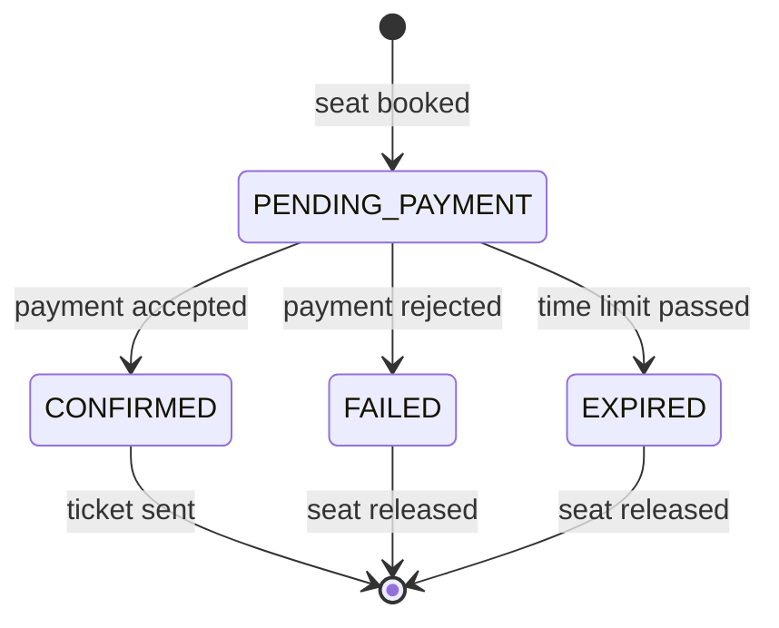
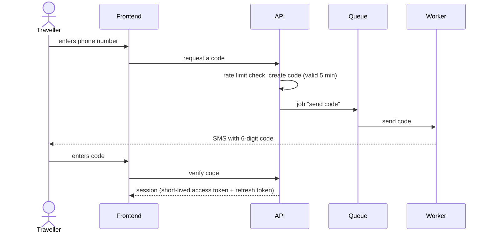
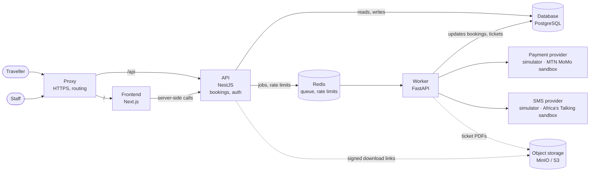
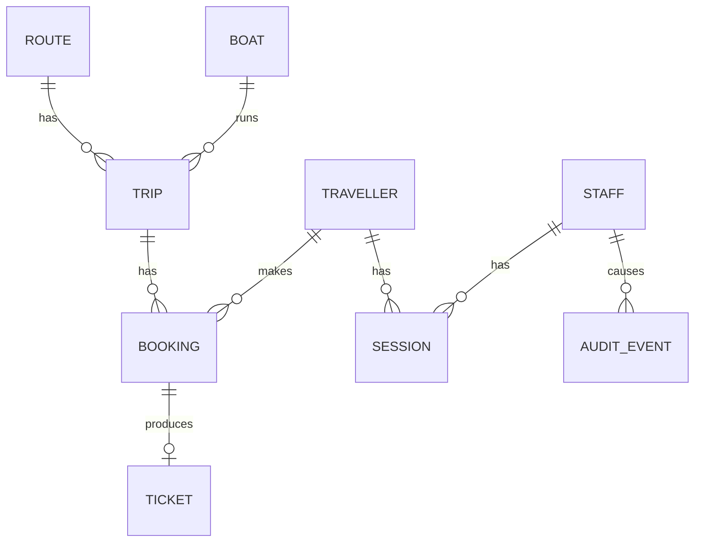

# App design: Kivu Ferry booking

## 1 · Purpose and scope

A full-stack ferry ticket booking product for Lake Kivu, serving the Congolese side of the lake (Goma, Bukavu, Idjwi, Minova, Kalehe), with fares in US dollars. It's designed as a real product, and built to be **operated**: deployed, scaled, broken and monitored.

**In scope:**
- A booking website for travellers: search trips, pick a seat, pay, follow the booking, view the ticket
- Traveller accounts: sign in with a phone number and a one-time code, "My trips"; booking as a guest stays possible
- An operations area for staff: sign in with two-factor authentication, follow and export bookings, with roles
- Everything behind them

**Planned:** a mobile app for travellers and a desktop app for operations staff, both using the same API as the website.

**Out of scope for now:** real payments and real SMS (a simulator locally, the MTN MoMo and Africa's Talking sandboxes in staging), refunds and cancellations, managing routes, boats and timetables from the interface.

## 2 · Actors

| Actor | What they do |
|---|---|
| Traveller (guest) | Searches trips, books a seat with a phone number, pays, receives a ticket |
| Traveller (signed in) | Everything a guest does, plus sees all their trips and doesn't retype their details |
| Agent (staff) | Follows bookings and looks up a traveller's booking at the port |
| Manager (staff) | Everything an agent does, plus exports bookings and manages staff accounts |
| Mobile money provider *(simulator locally, MTN MoMo sandbox in staging)* | Confirms or rejects payments, and calls the app back with the result |
| SMS provider *(simulator locally, Africa's Talking sandbox in staging)* | Delivers tickets and sign-in codes |

## 3 · Functional requirements

### Booking

| ID | Requirement |
|---|---|
| F1 | A traveller can search trips by origin, destination and date |
| F2 | A traveller can see which seats are still free on a trip, on a seat map |
| F3 | A traveller can book one seat, signed in or as a guest with a phone number |
| F4 | **A seat can never be sold twice**, even if two people book it at the same moment |
| F5 | Payment happens asynchronously; the booking is confirmed or failed afterwards |
| F6 | A seat held by an unpaid booking is released after a time limit |
| F7 | A confirmed booking produces exactly **one** ticket, sent by SMS, even if a step is retried |
| F8 | A traveller can follow the status of their booking and view their ticket |
| F8a | Each confirmed booking also gets a PDF ticket the traveller can download; only the booking's owner can download it, through a link that expires *(from chapter 09)* |

### Traveller accounts

| ID | Requirement |
|---|---|
| F9 | A traveller signs in with their phone number and a one-time code sent by SMS; there are no passwords |
| F10 | Bookings made as a guest with the same phone number appear in the account after signing in |
| F11 | A signed-in traveller sees their upcoming and past trips ("My trips") |
| F12 | A traveller can sign out on one device, or on all devices |
| F13 | A traveller can delete their account; their personal data is removed, while bookings are kept anonymised for accounting |

### Operations

| ID | Requirement |
|---|---|
| F14 | Staff sign in with email, password and a second factor (an authenticator app) |
| F15 | Agents can list, filter and search bookings by reference or phone number |
| F16 | Managers can also export bookings for a date range, and create, disable and assign roles to staff accounts |
| F17 | Every export and every change to a staff account is recorded with who did it and when |

### Booking lifecycle

### Traveller sign-in

## 4 · Operational requirements

These apply to every service: frontend, API and worker.

| ID | Requirement |
|---|---|
| O1 | Configured only through environment variables, checked at startup. The frontend reads its settings at runtime, so one build runs in every environment |
| O2 | A liveness check and a readiness check (can it reach its dependencies?) |
| O3 | Reports which version is running |
| O4 | Stops cleanly on shutdown, finishing in-flight work |
| O5 | Structured logs to standard output |
| O6 | Schema changes are versioned and applied separately from app startup |
| O7 | Services are stateless, so any instance can be stopped or added; sessions live in the database and Redis, never in a process |
| O8 | Exposes metrics: technical (latency, errors) and business (bookings, tickets sent, codes sent, sign-ins, queue length) |

### Security and personal data

| ID | Requirement |
|---|---|
| S1 | Sign-in codes expire after 5 minutes, allow at most 5 attempts, and are stored only as a hash |
| S2 | Code requests are rate-limited per phone number and per IP address, so the SMS bill can't be run up by abuse |
| S3 | Access tokens are short-lived (15 minutes); refresh tokens are stored hashed and can be revoked |
| S4 | Token signing keys can be rotated without signing everyone out |
| S5 | Staff passwords are hashed with a slow algorithm; staff accounts require a second factor |
| S6 | Every API endpoint checks the caller's role; the frontend hiding a button is never the only protection |
| S7 | Logs never contain phone numbers, codes, tokens or passwords; phone numbers are masked wherever staff see them |
| S8 | Backups are encrypted; deleted accounts are removed from the live database and age out of backups |
| S9 | Ticket files are never public: stored encrypted, reachable only through short-lived signed links, with names that can't be guessed |

### Testing support

| ID | Requirement | Why it matters |
|---|---|---|
| T1 | Can be filled with realistic data volumes (~1M bookings, ~100k travellers) | Performance problems only show up with real volumes |
| T2 | Failure can be injected on demand: slow or failing payments, failing SMS | Shows how the system behaves when providers fail |
| T3 | Sign-in works in test environments without a real phone (a fixed test code for test numbers only) | Lets load tests and end-to-end tests sign in |
| T4 | Each provider sits behind an adapter chosen by configuration: simulator or sandbox, with no code change | The same build runs on a laptop with no keys and in staging against real sandboxes |

## 5 · Quality targets

| Concern | Target |
|---|---|
| Search latency | p95 under 300 ms with ~1M bookings |
| Page load | Main pages show their main content in under 2.5 s (Largest Contentful Paint) for 75% of visits; checked on every change in the pipeline and measured on real visits |
| Sign-in code delivery | 95% of codes delivered within 30 s |
| Correctness | 0 double-sold seats under concurrent load |
| Reliability | A payment or SMS failure never loses a booking; retries never create duplicate tickets |
| Scalability | Frontend, API and worker scale independently |

## 6 · Architecture

Object storage (dashed) is added in chapter 09, together with PDF tickets (F8a, S9). Until then, tickets are sent by SMS only.

| Component | Responsible for | Not responsible for |
|---|---|---|
| **Frontend** | The booking site and the operations area; rendering pages; calling the API | Business rules, data access, deciding who may do what |
| **API** | Answering requests quickly; validating them; bookings; sign-in, sessions and roles; publishing jobs | Talking to external providers |
| **Worker** | Everything slow or unreliable: payments, tickets (SMS and PDF), sign-in codes, expiring unpaid bookings | Serving users directly |
| **Object storage** | Ticket PDFs (MinIO on a single server, S3 behind a CDN on AWS) | Anything the database must answer queries about |
| **Database** | The truth about trips, bookings, tickets, accounts and sessions; enforcing "one seat, one booking" | — |
| **Redis** | Handing work to the worker, with retries; counting requests for rate limits | Storing anything that can't be lost |

### Principles

- **The database guarantees correctness** (F4, F7). The queue and the services can fail or retry without breaking it.
- **The API never waits on an external provider.** A slow payment or SMS provider makes the queue grow; it doesn't slow down the API.
- **The frontend holds no business logic and no authority.** Every rule and every permission check lives in the API.
- **Authentication lives in the API, not in a separate service.** One fewer service to run, and the API already owns the data it protects. If more products ever share the same accounts, it can be moved out.

### Why a separate worker

Payments and SMS are slow, can fail, and need retries; expiring unpaid bookings runs with no request at all. Keeping this work out of the API means travellers never wait on a provider, and the two services scale on different signals: the API on traffic, the worker on queue length.

The worker is written in Python (FastAPI) on purpose, so the system has services in more than one language to build, test, package and deploy. A NestJS worker would serve the design equally well.

### Why the frontend is self-hosted

Vercel would be the simplest way to run a Next.js frontend: push and it's deployed, with a CDN and scaling included. Not using it is a **deliberate choice for learning**. Running Next.js yourself (its own container image, runtime configuration, a cache shared across replicas, static files on a CDN, zero-downtime deploys) is exactly the work a managed platform hides, and it's the work this lab is about. Details in [ADR-0002](../adr/0002-self-host-the-frontend.md).

## 7 · Data

| Entity | What it holds |
|---|---|
| **Route** | Origin and destination |
| **Boat** | Name and seat count |
| **Trip** | A route, a boat and a departure |
| **Booking** | A trip, a seat, a phone number, a status, and the traveller if signed in |
| **Ticket** | One per confirmed booking, with the location of its PDF file |
| **Traveller** | Phone number (unique), optional name, created and last-seen dates |
| **Staff** | Name, email, password hash, second-factor secret, role (agent or manager), home port, invited, active or disabled |
| **Session** | Who it belongs to, a hashed refresh token, device, expiry, revoked or not |
| **Audit event** | Which staff member did what, to what, and when |

Sign-in codes and rate-limit counters are short-lived and live in Redis, not in the database.

## 8 · Decisions left for implementation

Each becomes an ADR in [`docs/adr/`](../adr/) when it's made:

- Which queue library works across Node and Python
- Which migration tool
- How the services query the database
- Which libraries handle sessions, password hashing and the second factor in the API
- Where token signing keys are stored and how they're rotated
